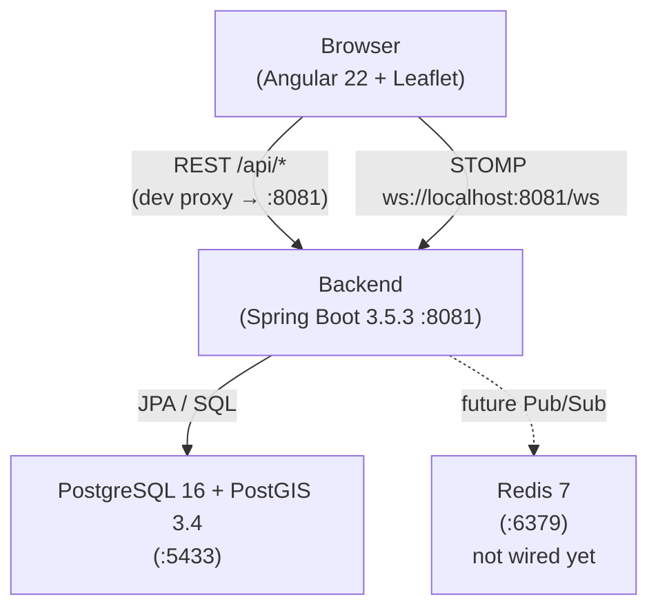

# Snapland GIS

A collaborative GIS application where multiple users can draw, edit, and analyse land areas on a shared map in real time.

This repository is a take-home assignment implementing a simplified, prototype-grade version of the described system. It demonstrates the core data model, spatial operations, real-time collaboration mechanics, and an authentication skeleton.

---

## Features

| Feature | Status |
|---------|--------|
| Draw and view polygon areas on a map | Implemented |
| Create, update, and delete areas with OCC | Implemented |
| Full version history with point-in-time snapshots | Implemented |
| Restore a previous version | Implemented |
| Real-time area events over WebSocket (STOMP) | Implemented |
| WebSocket JWT authentication | Implemented |
| Prototype registration and login (email only, no password) | Implemented — prototype |
| Geometry validation (simple, non-self-intersecting polygons) | Implemented |
| Area size calculation (km²) | Implemented — PostGIS (authoritative); live frontend preview while drawing and editing |
| Viewport bounding-box spatial querying (PostGIS / GiST) | Implemented |
| Map / satellite layer switching (OSM ↔ satellite) | Implemented |
| Satellite tile layer | Implemented — Esri World Imagery (temporary; see [Map Providers](#map-providers)) |
| Per-user drawing action rate limiting | Implemented — 50 mutations/minute/user; fixed-window in-process limiter |
| Area mutation audit trail | Implemented — AreaVersion records actor, action, timestamp, and resulting state for every committed mutation |
| Custom Micrometer metrics + Prometheus endpoint | Implemented — committed mutation counters (by change type), version conflict counter, rate limit rejection counter, active WebSocket session gauge; exposed at `/actuator/prometheus` |
| WebSocket graceful degradation and reconnect | Implemented — auto-reconnect with JWT refresh on every attempt; viewport reconciliation via REST after reconnect; "Reconnecting" status banner |
| Active users / presence | Implemented — REST snapshot + WebSocket incremental events; race-safe snapshot with event buffering; multi-tab collapses to single presence entry |
| Deleted Areas management | Implemented — Deleted Areas panel lists soft-deleted areas with name and deletion date; Restore and Delete permanently actions |
| Permanent delete with data purge | Implemented — explicit user action physically removes Area and version history; OCC-protected; DELETED state required |
| Workspace membership authorization | Not implemented — known limitation |
| Password-based authentication | Not implemented — prototype only |
| GovMap integration | Not implemented — see [Map Providers](#map-providers) |
| Frontend tests | Not implemented |

---

## Technology Stack

### Backend

| | |
|--|--|
| Language | Java 21 |
| Framework | Spring Boot 3.5.3 |
| Build | Maven (wrapper included: `./mvnw`) |
| Database | PostgreSQL 16 + PostGIS 3.4 |
| Schema migrations | Flyway |
| ORM | Spring Data JPA / Hibernate |
| Security | Spring Security, OAuth2 Resource Server (JWT / HMAC-SHA256) |
| WebSocket | Spring WebSocket, STOMP |
| Spatial library | JTS Topology Suite 1.20.0 |

### Frontend

| | |
|--|--|
| Framework | Angular 22 |
| Language | TypeScript |
| Map | Leaflet.js 1.9.4 |
| Real-time | @stomp/stompjs 7.0.0 |

### Infrastructure

| | |
|--|--|
| Database | `postgis/postgis:16-3.4` (Docker) |
| Cache / Pub/Sub | Redis 7-alpine (Docker — not yet wired to the application) |

---

## Architecture Overview



The backend exposes:
- A REST API under `/workspaces/{workspaceId}/areas` for area CRUD and version history.
- A WebSocket endpoint at `/ws` (STOMP protocol) for real-time area events.
- Authentication endpoints at `/auth/register` and `/auth/login`.

The Angular frontend proxies REST calls through the Angular dev server (`/api` → `http://localhost:8081`) and connects to the WebSocket URL directly.

---

## Core Data Model

```
workspace
  └── workspace_member  (user ↔ workspace, role)
        └── users

area  (belongs to workspace)
  ├── geometry      POLYGON, SRID 4326
  ├── area_km2      NUMERIC  (computed by PostGIS on write)
  ├── status        ACTIVE | DELETED
  └── current_version  → area_version.version

area_version  (append-only log)
  ├── version       INTEGER (monotonically increasing per area)
  ├── change_type   CREATED | UPDATED | DELETED | RESTORED
  └── snapshot of name / geometry / area_km2 / status at that version
```

**Concurrency model**: Optimistic Concurrency Control (OCC). Every mutating request carries `expectedVersion`; the backend rejects with `409 VERSION_CONFLICT` if `current_version ≠ expectedVersion`.

**Spatial index**: Partial GiST index on `area.geometry WHERE status = 'ACTIVE'` for efficient spatial queries over non-deleted areas.

---

## Authentication

The prototype uses email-only authentication — no passwords. Any email registers a new account; submitting an existing email on the login screen returns a fresh JWT. Email ownership is not verified: anyone who knows a registered email can authenticate as that user.

| Endpoint | Method | Auth required | Description |
|----------|--------|:---:|-------------|
| `/auth/register` | POST | No | Create account, return JWT |
| `/auth/login` | POST | No | Return JWT for existing email |
| `/dev/token` | POST | No | **Dev profile only** — token for the seeded dev user |

JWT tokens are signed with HMAC-SHA256. The `sub` claim holds the user UUID. Tokens expire after 24 hours (configurable via `app.auth.jwt-expiration`).

WebSocket connections authenticate via a `Authorization: Bearer <token>` header in the STOMP `CONNECT` frame. Browser WebSocket clients cannot set HTTP headers during the HTTP upgrade, so authentication happens at the STOMP layer.

---

## Real-Time Collaboration

Area mutations publish events over STOMP to a per-workspace topic: `/topic/workspace/{workspaceId}`.

Event types: `AREA_CREATED`, `AREA_UPDATED`, `AREA_DELETED`, `AREA_RESTORED`, `AREA_PERMANENTLY_DELETED`.

Example payload:

```json
{
  "type": "AREA_UPDATED",
  "workspaceId": "00000000-0000-0000-0000-000000000002",
  "timestamp": "2026-10-02T12:34:56.789Z",
  "payload": {
    "id": "...",
    "name": "...",
    "currentVersion": 3,
    "status": "ACTIVE",
    "geometry": { "type": "Polygon", "coordinates": [...] },
    "areaKm2": 30.7
  }
}
```

Events are broadcast only after the database transaction commits. If the transaction rolls back (OCC conflict, invalid geometry), no event is published.

**Reconnect and reconciliation**: The `@stomp/stompjs` client reconnects automatically after a connection loss (3 s delay). Before every connection attempt, the `beforeConnect` hook reads a fresh JWT from `AuthService` — ensuring reconnects always use the live token. If the token has been cleared (expired JWT, logout), the reconnect loop is stopped immediately. On reconnect, the frontend reloads all Areas for the current viewport via REST, recovering any changes missed during disconnection. A "Reconnecting realtime updates…" banner is shown at the bottom of the map while the connection is down, and disappears once the connection is restored. REST area mutations remain fully functional while the WebSocket is disconnected.

**Current limitation**: The in-process Spring `SimpleBroker` broadcasts only to subscribers connected to the same JVM instance. Multi-instance scaling requires Redis Pub/Sub fan-out, which is modelled in the design but not yet implemented.

### Active Users / Presence

When a user establishes a STOMP connection, `PresenceService` broadcasts a `PRESENCE_JOINED` event to `/topic/workspace/{workspaceId}/presence`. When the last session for a user disconnects, `PRESENCE_LEFT` is broadcast. Multiple browser tabs for the same user collapse to a single presence entry.

On (re)connect, the frontend calls `GET /workspaces/{workspaceId}/presence` to retrieve the current snapshot. Events received while the snapshot request is in flight are buffered and replayed after the snapshot is applied, preventing race-condition gaps.

The presence panel in the lower-left corner of the map shows all currently active users. Presence state is ephemeral (cleared on server restart) and intentionally not persisted to the database.

---

### Deleted Areas Management

When an area is soft-deleted it disappears from the map but is retained indefinitely. Users can access deleted areas via the **Deleted Areas** button on the map, which opens a panel listing each deleted area's name and deletion date with Restore and Delete permanently actions.

**Restore** calls the existing restore endpoint, making the area ACTIVE again. If the area is within the current viewport, it reappears on the map for all connected users via the `AREA_RESTORED` WebSocket event.

**Delete permanently** opens a browser confirm dialog, then calls `DELETE /workspaces/{wid}/areas/{aid}/permanent?expectedVersion=N`. This physically removes the Area row and all its AreaVersion history from the database. The operation requires the area to already be in `DELETED` state (permanent deletion of an ACTIVE area returns `409 AREA_NOT_DELETED`). The `expectedVersion` parameter is required for OCC: if the area was concurrently modified since the panel was loaded, the backend returns `409 VERSION_CONFLICT` and the client reloads the deleted areas list.

An `AREA_PERMANENTLY_DELETED` WebSocket event is broadcast after commit. Clients with the Deleted Areas panel open remove the area from the list. If a client still has the just-deleted single-area panel open for the same area, that panel is also cleared.

**Retention policy:** DELETED areas are retained indefinitely with no automatic expiry or scheduled cleanup. The only way to permanently remove an area is the explicit user action described above.

---

## Version History

Every area mutation appends a snapshot row to `area_version`. Version numbers are monotonically increasing per area. History is retained until the area is permanently deleted.

Restoring a version creates a new `area_version` entry with `change_type = RESTORED`, copying the snapshot from the target version.

| Method | Path | Description |
|--------|------|-------------|
| `GET` | `/workspaces/{wid}/areas/{aid}/versions` | All versions, newest first |
| `POST` | `/workspaces/{wid}/areas/{aid}/versions/{v}/restore` | Restore to version `v` |

---

## Map Providers

The map displays a satellite base layer. The original requirement specifies GovMap (Israel Mapping Center) as the satellite imagery source.

The official public GovMap WMS endpoint is CORS-enabled, but the layers it exposes are cadastral and vector data; no aerial or orthophoto layer is available through that endpoint. No other documented official WMS, WMTS, or XYZ tile endpoint for GovMap aerial imagery could be verified for third-party use. Esri World Imagery is therefore used as a temporary prototype provider.

See [`docs/research/GOVMAP_SATELLITE_RESEARCH.md`](docs/research/GOVMAP_SATELLITE_RESEARCH.md) and [`docs/research/GOVMAP_XYZ_ORTHOPHOTO_FINDINGS.md`](docs/research/GOVMAP_XYZ_ORTHOPHOTO_FINDINGS.md) for the full investigation.

Replacing the tile provider requires updating the tile URL configuration in the map component — the component treats the tile URL as a configuration value.

---

## API Overview

All area and version endpoints require a valid JWT in the `Authorization: Bearer <token>` header.

### Areas

| Method | Path | Description |
|--------|------|-------------|
| `POST` | `/workspaces/{wid}/areas` | Create area |
| `GET` | `/workspaces/{wid}/areas?bbox={minLon,minLat,maxLon,maxLat}` | Spatial viewport query — active areas intersecting the bounding box |
| `GET` | `/workspaces/{wid}/areas/{aid}` | Get single area |
| `PUT` | `/workspaces/{wid}/areas/{aid}` | Update area (name and/or geometry) |
| `DELETE` | `/workspaces/{wid}/areas/{aid}?expectedVersion={n}` | Soft-delete area |
| `GET` | `/workspaces/{wid}/areas/deleted` | List all soft-deleted areas (id, name, currentVersion, deletedAt) |
| `DELETE` | `/workspaces/{wid}/areas/{aid}/permanent?expectedVersion={n}` | Permanently delete a DELETED area and its version history |

### Version History

| Method | Path | Description |
|--------|------|-------------|
| `GET` | `/workspaces/{wid}/areas/{aid}/versions` | Full version log |
| `POST` | `/workspaces/{wid}/areas/{aid}/versions/{v}/restore` | Restore to version `v` |

### Authentication

| Method | Path | Description |
|--------|------|-------------|
| `GET` | `/workspaces/{wid}/presence` | Active users in workspace — returns `[{id, name}]` |

### Authentication

| Method | Path | Description |
|--------|------|-------------|
| `POST` | `/auth/register` | Register new user — returns JWT |
| `POST` | `/auth/login` | Login existing user — returns JWT |

### Observability

| Method | Path | Description |
|--------|------|-------------|
| `GET` | `/actuator/health` | Liveness / readiness |
| `GET` | `/actuator/prometheus` | Prometheus metrics scrape endpoint |

There is no OpenAPI / Swagger UI.

---

## Running Locally

### Prerequisites

| Tool | Version |
|------|---------|
| Docker + Docker Compose | Any recent |
| Java | 21 |
| Maven | Use `./mvnw` wrapper (no separate install needed) |
| Node.js | ≥ 20.19.0 |
| npm | Bundled with Node.js |

### Step 1 — Start infrastructure

```bash
docker compose up -d
```

Wait until postgres is healthy:

```bash
docker compose ps
```

The `postgres` container must reach `(healthy)` before the backend can connect. Redis starts alongside postgres but is not used by the application in the current implementation.

### Step 2 — Start the backend

The `dev` Spring profile supplies all required secrets and seeds the database with a development user and shared workspace. No environment variables are required for local development.

```bash
cd backend
./mvnw spring-boot:run -Dspring-boot.run.profiles=dev
```

The backend starts at **http://localhost:8081**.

Health check:

```bash
curl http://localhost:8081/actuator/health
```

Expected response: `{"status":"UP",...}`

### Step 3 — Start the frontend

```bash
cd frontend
npm install          # first run, or after dependency changes
npm start            # Angular dev server at http://localhost:4201
```

Open **http://localhost:4201** in a browser.

The dev server proxies `/api/*` requests to `http://localhost:8081`. WebSocket connects directly to `ws://localhost:8081/ws`.

### Prototype authentication flow

1. Open http://localhost:4201 — the auth guard redirects unauthenticated users to `/auth`.
2. Enter any email address and a display name to register.
3. To log in as an existing user, enter the same email on the login screen.
4. A JWT is stored in `localStorage` and attached to all subsequent requests.

---

## Configuration

### Local dev — `application-dev.yml`

All values are preset; no `.env` file is needed.

| Property | Value |
|----------|-------|
| `app.auth.jwt-secret` | `dev-only-secret-not-for-production-use-aabbccddeeff001122334455` |
| `app.auth.jwt-expiration` | `PT24H` |
| `app.auth.jwt-issuer` | `snapland` |
| `app.dev.user-id` | `00000000-0000-0000-0000-000000000001` |
| `app.prototype.workspace-id` | `00000000-0000-0000-0000-000000000002` |
| `app.rate-limit.drawing-actions.max-actions` | `50` |
| `app.rate-limit.drawing-actions.window` | `PT1M` |

### Production — required environment variables

| Variable | Description |
|----------|-------------|
| `JWT_SECRET` | HMAC-SHA256 signing key (minimum 32 characters) |
| `PROTOTYPE_WORKSPACE_ID` | UUID of the shared prototype workspace |

The rate limit defaults (`50` mutations per minute) are defined in `application.yml` and can be overridden with standard Spring property mechanisms.

Standard Spring Boot datasource properties (`spring.datasource.*`) override the default connection settings.

---

## Testing

Integration tests use Testcontainers to start a dedicated PostGIS container per test class. No local database is required; Docker must be running.

```bash
cd backend
./mvnw test
```

| Test class | Areas covered |
|------------|---------------|
| `AreaApiIntegrationTest` | Create, list, get; geometry validation; workspace scoping |
| `AreaUpdateIntegrationTest` | Update mutations, OCC, concurrent write contention |
| `AreaDeleteRestoreIntegrationTest` | Soft-delete, restore, OCC, error cases |
| `AreaVersionHistoryIntegrationTest` | Version log ordering, snapshots, restore, 404/409 cases |
| `AreaWebSocketIntegrationTest` | Event publishing for all mutation types; workspace isolation |
| `AreaWebSocketAuthIntegrationTest` | WebSocket JWT acceptance and rejection (expired, wrong key, missing) |
| `AuthIntegrationTest` | Registration, login, duplicate detection, JWT claims, workspace membership |
| `DrawingRateLimitIntegrationTest` | Per-user quota enforcement, 429 response contract, independent quotas, window reset, no DB write on reject, failed mutations count |
| `AreaAuditIntegrationTest` | AreaVersion audit trail: exact actor per mutation type, changeType, version, timestamp; failed mutation creates no committed version |
| `MetricsIntegrationTest` | Custom Micrometer metrics: committed mutation counters (all 4 change types), version conflict counter, rate limit rejection counter, Prometheus scrape endpoint, WebSocket session gauge (connect / disconnect / rejected connect / duplicate disconnect) |
| `PresenceIntegrationTest` | Presence REST snapshot (auth, unknown workspace, empty list, user included after connect); PRESENCE_JOINED and PRESENCE_LEFT events; multi-tab session collapsing; two-user snapshot |
| `DeletedAreasIntegrationTest` | Deleted areas API: deleted area appears, active area excluded, viewport exclusion, restore removes from list, deletedAt timestamp |
| `PermanentDeleteIntegrationTest` | Physical removal, AreaVersion purge, ACTIVE area rejection, auth requirement, workspace scoping, double-delete 404, ABA stale-version VERSION_CONFLICT, unknown workspace, stale expectedVersion, response body |
| `SchemaIntegrationTest` | Database schema constraints and PostGIS spatial queries |
| `SnaplandGisApplicationTests` | Spring context loads |

**146 integration tests, 0 failures** (verified by `./mvnw test`). Frontend tests: not implemented.

---

## Database

### Schema

Flyway migrations are applied automatically on startup.

| Migration | File | Description |
|-----------|------|-------------|
| V1 | `V1__enable_postgis.sql` | Enable PostGIS extension |
| V2 | `V2__core_schema.sql` | All tables: `users`, `workspace`, `workspace_member`, `area`, `area_version`; indexes |

### Local connection

| Property | Value |
|----------|-------|
| Host | `localhost:5433` |
| Database | `snapland_gis` |
| Username | `snapland` |
| Password | `snapland` |

### Performance

A partial GiST spatial index covers `area.geometry WHERE status = 'ACTIVE'`. This supports efficient bounding-box and containment queries against non-deleted areas while keeping deleted rows out of the index.

---

## Security

| Mechanism | Detail |
|-----------|--------|
| JWT signing | HMAC-SHA256; 24-hour expiry (configurable) |
| REST authentication | Spring Security OAuth2 Resource Server validates all requests except `/auth/**` and `/dev/token` |
| WebSocket authentication | `JwtChannelInterceptor` validates the JWT in the STOMP `CONNECT` frame |
| Input validation | Bean Validation on all request DTOs; polygon validity enforced via JTS before persistence |
| Drawing action rate limiting | Fixed-window per-user limiter (50/min default); enforced as a Spring MVC interceptor; returns `429` with `Retry-After` header |
| Area mutation audit trail | Every committed Area mutation (create/update/delete/restore) writes an immutable AreaVersion row recording the authenticated actor (`created_by`), action (`change_type`), timestamp (`created_at`), and full resulting Area state |
| Prometheus endpoint | `/actuator/prometheus` permit-all (prototype simplification); `health` and `prometheus` are the only actuator endpoints exposed |
| 401 handling | Angular interceptor clears the stored token and redirects to `/auth` on any 401 response |

**Known gap**: Workspace membership is not enforced in `AreaService`. Any authenticated user can read or mutate areas in any workspace. This is documented in `docs/DESIGN.md` as a known limitation of the prototype.

---

## Known Limitations

These are deliberate prototype constraints, not defects.

| Limitation | Detail |
|------------|--------|
| No password authentication | Any email registers or logs in; suitable only for a closed demo |
| No workspace authorization | All authenticated users can access all workspaces |
| Single-instance WebSocket broker | Spring `SimpleBroker` does not fan out across multiple backend instances; this also means presence is per-instance — users connected to different instances will not see each other |
| Redis not integrated | Redis runs in `docker-compose` but has no application code |
| Static workspace ID in frontend | `environment.ts` hardcodes `workspaceId` |
| No OpenAPI documentation | No Swagger UI or OpenAPI spec |
| No frontend tests | Angular components have no unit or e2e tests |
| GovMap not integrated | Esri World Imagery used as a temporary tile source |
| In-process rate limiter only | Drawing action rate limit is single-JVM and resets on restart; not effective across multiple instances |
| Audit trail covers Area mutations only | Non-Area activity (login, read requests) has no dedicated persistent audit trail. User registration is implicitly recorded by `users.created_at`. Login has no persistent trace. |
| Prometheus endpoint is unauthenticated | `/actuator/prometheus` is permit-all as a prototype simplification. In production, restrict to an internal network, a separate management port, or an infrastructure ACL. |

### Geographic Caching

Geographic query caching was evaluated but is not currently enabled. The PostGIS partial GiST index provides efficient viewport queries for the prototype data volume. If query latency becomes a bottleneck at production scale, a Web Mercator tile cache (z/x/y keys, workspace-wide invalidation on mutation) is the recommended next step. See `docs/DESIGN.md` — *Geographic Data Caching Decision* for the full evaluation.

---

## Production / Scaling

The design document (`docs/DESIGN.md`) describes the intended production path. What the current prototype requires before production use:

1. **Strong authentication** — replace email-only login with a credential-backed identity provider or add a password field with bcrypt.
2. **Workspace authorization** — enforce workspace membership checks in `AreaService`.
3. **Redis Pub/Sub** — wire `AreaEventRelay` and `PresenceService` to Redis for multi-instance WebSocket fan-out and cross-instance presence.
4. **Production rate limiting** — move the in-process drawing action rate limiter to the API Gateway with a shared backing store (e.g., Redis sliding window) to enforce limits across all instances and survive restarts.
5. **Secret management** — rotate the JWT secret; manage `JWT_SECRET` through a secrets manager (Vault, AWS KMS, etc.).
6. **TLS** — terminate HTTPS / WSS at a load balancer or reverse proxy.
7. **Prometheus endpoint security** — restrict `/actuator/prometheus` to an internal network, a separate management port, or an infrastructure ACL (Prometheus scraper, not public browsers).

---

## Project Structure

```
snapland-gis/
├── backend/
│   ├── src/main/java/com/snapland/gis/
│   │   ├── area/          # Area entity, repository, service, controller, DTOs
│   │   ├── auth/          # AuthService, AuthController, JwtIssuer, DTOs
│   │   ├── common/        # Exception hierarchy, GlobalExceptionHandler, ApiError
│   │   ├── config/        # SecurityConfig, ClockConfig, JwtProperties, PrototypeProperties
│   │   ├── ratelimit/     # DrawingRateLimiter, DrawingRateLimitInterceptor, DrawingRateLimitProperties
│   │   ├── metrics/       # AreaMetricsListener, WebSocketSessionMetrics
│   │   ├── dev/           # DevProperties, DevDataInitializer, DevTokenController
│   │   ├── realtime/      # WebSocketConfig, JwtChannelInterceptor, AreaEventRelay, PresenceService, PresenceController
│   │   ├── user/          # User entity, UserRepository
│   │   └── workspace/     # Workspace, WorkspaceMember entities and repositories
│   └── src/main/resources/
│       ├── application.yml
│       ├── application-dev.yml
│       └── db/migration/
├── frontend/
│   └── src/app/
│       ├── area/          # AreaService, area model, edit-panel component
│       ├── auth/          # AuthService, AuthComponent, authGuard, authInterceptor
│       ├── map/           # MapComponent (Leaflet integration)
│       └── realtime/      # RealtimeService (STOMP client)
├── docs/
│   ├── REQUIREMENTS.md
│   ├── DESIGN.md
│   └── TEST_CASES.md
├── docker-compose.yml
└── README.md
```

---

## Technical Decisions

| Decision | Rationale |
|----------|-----------|
| PostgreSQL + PostGIS as authoritative spatial store | Full spatial type support, geometry validation, `ST_Area` for km² calculation, GiST spatial indexes |
| OCC via `current_version` | Avoids long-held locks; conflict detection at the application boundary; version history naturally enforces ordering |
| Append-only `area_version` log | Immutable change history; enables point-in-time restore without complex undo logic |
| STOMP over WebSocket | Topic-based subscription model without a broker dependency; `@stomp/stompjs` widely available |
| JWT in STOMP CONNECT header | Browser WebSocket API cannot set custom HTTP headers on the HTTP upgrade request |
| Spring Security OAuth2 Resource Server | Standardised JWT validation and principal propagation without a full OAuth2 provider |
| Email-only prototype auth | Minimises scope; evaluators can register and use the product without password infrastructure |
| Testcontainers with real PostGIS | Avoids mock/real divergence for spatial queries, geometry constraints, and schema validation |
| `application-dev.yml` provides all secrets | No `.env` file or manual setup needed for local development |

---

## Future Work

Items designed but not yet implemented:

- Redis Pub/Sub fan-out for horizontal WebSocket scaling
- Workspace membership authorization
- Password-based (or OAuth2-backed) authentication
- Presence indicators (who is currently editing which area)
- GovMap tile integration (requires a verified, officially documented tile endpoint for aerial imagery)
- Spatial queries: find areas near a point (proximity / distance search)
- Role-based access control within workspaces
- OpenAPI specification and Swagger UI
- Frontend component tests and e2e tests
- Production deployment configuration (Docker images, Kubernetes manifests)

---

## Documentation

| Document | Contents |
|----------|----------|
| [`docs/REQUIREMENTS.md`](docs/REQUIREMENTS.md) | Functional and non-functional requirements |
| [`docs/DESIGN.md`](docs/DESIGN.md) | System architecture, data model, API contracts, design decisions |
| [`docs/TEST_CASES.md`](docs/TEST_CASES.md) | Test case specifications by feature area |
| [`CLAUDE.md`](CLAUDE.md) | Repository working rules for AI-assisted development |
